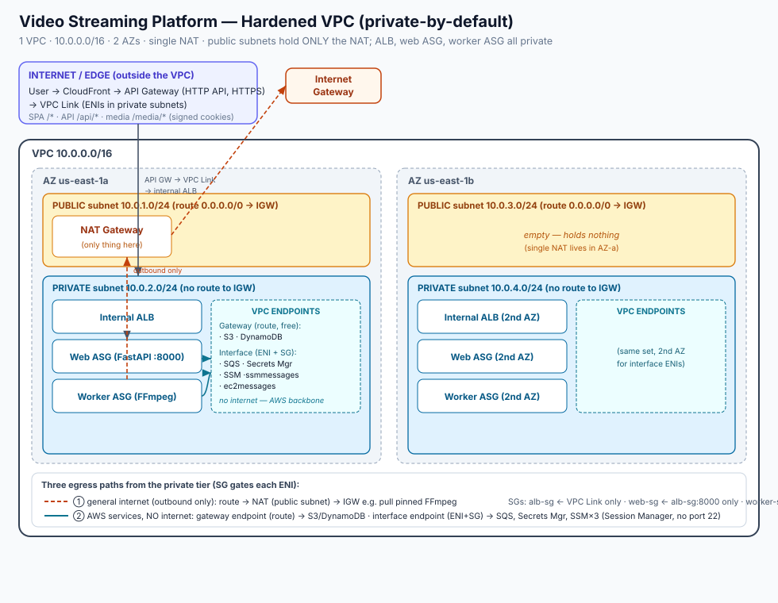

# VPC Connectivity Model — IGW, Route, NAT, VPC Endpoint & Security Group

> Part of [[learning-plan/04-networking/04-networking|Networking & Content Delivery]].
> Ties together [[learning-plan/04-networking/vpc-subnets|VPC Subnets]] (routes,
> IGW, NAT basics) and
> [[learning-plan/04-networking/security-groups-vs-private-network|Security Groups
> vs Private Network]] (the "road vs door" layering). Concrete example throughout:
> the hardened [[projects/video-streaming-app|Video Streaming Platform]] network.

Five constructs people constantly mention together. The key to not confusing them
is that **they don't all operate at the same layer**:

- **Route, IGW, NAT Gateway, VPC Endpoint** answer *"is there a path, and where
  does it go?"* — **connectivity (the road).**
- **Security Group** answers *"given a path exists, is this specific traffic
  allowed?"* — **filtering (the door).**

So the security group is a different *kind* of thing: it never routes traffic
anywhere, it permits or blocks it. The four connectivity pieces build the road;
the SG is the door on it. (Same "is there a road? → is the door unlocked?" model
as the [[learning-plan/04-networking/security-groups-vs-private-network|security
groups note]].)

## The comparison

| | Internet Gateway | Route | NAT Gateway | VPC Endpoint | Security Group |
| --- | --- | --- | --- | --- | --- |
| **Layer** | Connectivity (road) | Connectivity (road) | Connectivity (road) | Connectivity (road) | **Filtering (door)** |
| **What it is** | VPC's connection to the internet | Rule: "dest X → target Y" | Outbound-only internet relay | Private path to an AWS service (no internet) | Virtual firewall on an instance/ENI |
| **Role** | The VPC's exit/entry point | **Directs** traffic to a target | Lets private subnets reach *out* to the internet | Reaches **AWS services** off the internet entirely | **Allows/denies** traffic on a path |
| **Direction** | Two-way (in + out) | — (a pointer) | One-way (outbound initiated) | Outbound-initiated to the service | Stateful (allow in → return auto-allowed) |
| **Operates on** | The whole VPC | A subnet (via its route table) | Traffic routed to it | S3/DynamoDB (gateway) or many services (interface) | A specific instance/ENI |
| **Decides** | — (just the door to the net) | *Where* traffic goes | *How* private subnets egress to internet | Whether AWS-service traffic avoids the internet | *Whether* specific ports/sources pass |
| **Analogy** | Building's door to the street | Sign/arrow directing traffic | One-way revolving exit | Private corridor to the AWS "mall" next door | Bouncer checking each person at a door |

## Each, briefly

- **Internet Gateway (IGW)** — one per VPC, the VPC's single **two-way** door to
  the internet; also does public↔private IP translation. Useless alone — a
  **route** must point at it. (Full detail in
  [[learning-plan/04-networking/vpc-subnets|VPC Subnets]].)
- **Route** — a route-table rule `dest CIDR → target`. The **glue**: it's what
  actually sends a subnet's traffic to the IGW / NAT / endpoint / `local`. Public
  vs private subnet is defined *entirely* by what's in the route table
  (`0.0.0.0/0 → IGW` = public).
- **NAT Gateway** — lets **private** subnets reach the internet **outbound only**
  (updates, API calls, downloads) with no inbound reachability. It **lives in a
  public subnet** (needs its own route to the IGW) but **serves** private subnets.
  The internet can never initiate a connection back in — that asymmetry is the
  point.
- **VPC Endpoint** — a path to **AWS services** (S3, DynamoDB, SQS, SSM, …) with
  **no internet at all** (no IGW, no NAT). A third egress option. Two kinds:
  - **Gateway endpoint** (S3 + DynamoDB only) — implemented as a **route** entry
    (`→ vpce-xxxx`) in the subnet's route table. Traffic goes over the AWS
    backbone. Free, no ENI. ("Gateway endpoints keep S3/DynamoDB off the NAT.")
  - **Interface endpoint** (most other services) — implemented as an **ENI** (a
    private IP) in your subnet via PrivateLink; a **security group** on the
    endpoint gates who can reach it. (How Session Manager reaches a private
    instance with no port 22.)

  Note the tie-back: a *gateway* endpoint **is a route**; an *interface* endpoint
  **is an ENI guarded by a security group**.
- **Security Group** — stateful per-instance/ENI firewall. Doesn't choose a path;
  says yes/no to traffic on whatever path the route chose. (Detail in the
  [[learning-plan/04-networking/security-groups-vs-private-network|security groups
  note]].)

## How they interlock — the three egress paths

The clearest picture: a **private** instance has **three possible ways out**, each
a different route target, and the security group gates traffic on whichever path
the route picks.

```
private instance ──(security group: is this traffic allowed?)──┐
                                                               │  route table picks the destination:
   ┌────────────────────────────────────────────────────────────┤
   │ 0.0.0.0/0 → NAT Gateway ─► (NAT sits in a public subnet) 0.0.0.0/0 → IGW ─► internet   (general internet, outbound only)
   │ pl-S3/DDB → Gateway Endpoint ─► AWS backbone ─► S3 / DynamoDB                            (AWS service, NO internet)
   │ → interface-endpoint private IP ─► PrivateLink ─► SSM / etc.                             (AWS service, NO internet)
   └────────────────────────────────────────────────────────────┘
```

- **Route** is the switch choosing the path (NAT vs gateway endpoint vs the
  interface endpoint's IP vs `local`).
- **IGW** is reached *only* via the NAT's public-subnet route — it's the single
  true internet exit. A private instance is never directly behind the IGW, which
  is exactly *why* it's unreachable from the internet.
- **NAT** = the internet path (outbound only); **VPC Endpoint** = the AWS-service
  path (no internet).
- **Security Group** spans all paths as the per-ENI filter — orthogonal to which
  path was chosen.

## One-sentence relationships

- **Route** chooses the destination; it's the glue that makes the other
  connectivity pieces actually carry traffic.
- **IGW** is the VPC's one two-way internet door; **NAT** is an outbound-only
  front-end that still exits through the IGW; **VPC Endpoint** skips the internet
  entirely to reach AWS services (gateway = a route, interface = an ENI).
- **Security Group** is orthogonal — not a path but a stateful allow/deny applied
  once a path exists.

## Worked example — the video platform's "private-by-default" network



[[projects/video-streaming-app|Video Streaming (hardened)]] is this model in
miniature (diagram above, drawn from its `network_stack.py`):

- **Routes** send the private tier's traffic to the **NAT** (general internet,
  e.g. pulling the pinned FFmpeg build) or to **gateway endpoints** (S3/DynamoDB,
  off the NAT).
- **Interface endpoints** (`ssm`, `ssmmessages`, `ec2messages`) give **Session
  Manager** a path to the private worker with **no port 22 anywhere**.
- The **IGW** sits only behind the single **NAT** in a public subnet; the public
  subnets hold *nothing else*.
- **Security groups** gate every ENI — e.g. `worker-sg` has **zero inbound rules**
  (the worker only polls SQS outbound), and the internal ALB's SG admits traffic
  only from the VPC Link's SG.

That's how "everything private" still functions: three purpose-built egress paths
instead of public IPs, with security groups as the filter on each.

## Exam-relevant notes

- **Public vs private subnet = route table only** (`0.0.0.0/0 → IGW` or not).
- **IGW** two-way; **NAT** outbound-only and lives in a *public* subnet while
  serving *private* ones.
- **Reach AWS services without the internet** → **VPC endpoint**: *gateway*
  (S3/DynamoDB, a route, free) vs *interface* (ENI + SG, PrivateLink, most other
  services).
- **"Connect to a private instance, no port 22"** → **Session Manager via SSM
  interface endpoints**.
- **Security group ≠ routing** — it filters traffic on an existing path; it's
  stateful; it can't create or choose a path.
